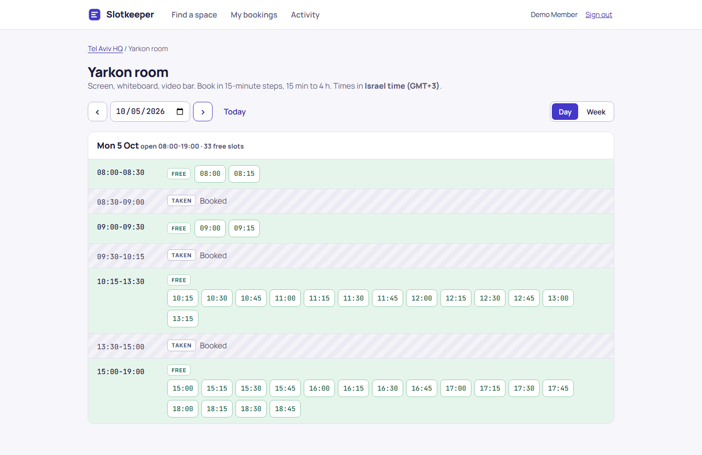
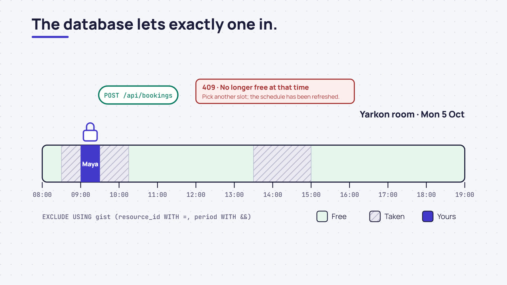
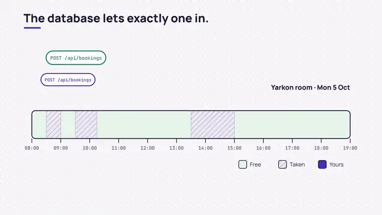
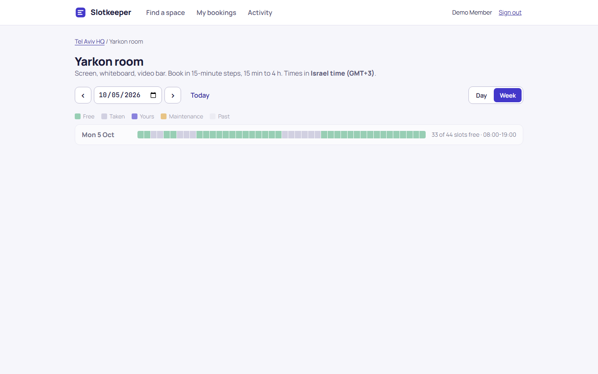
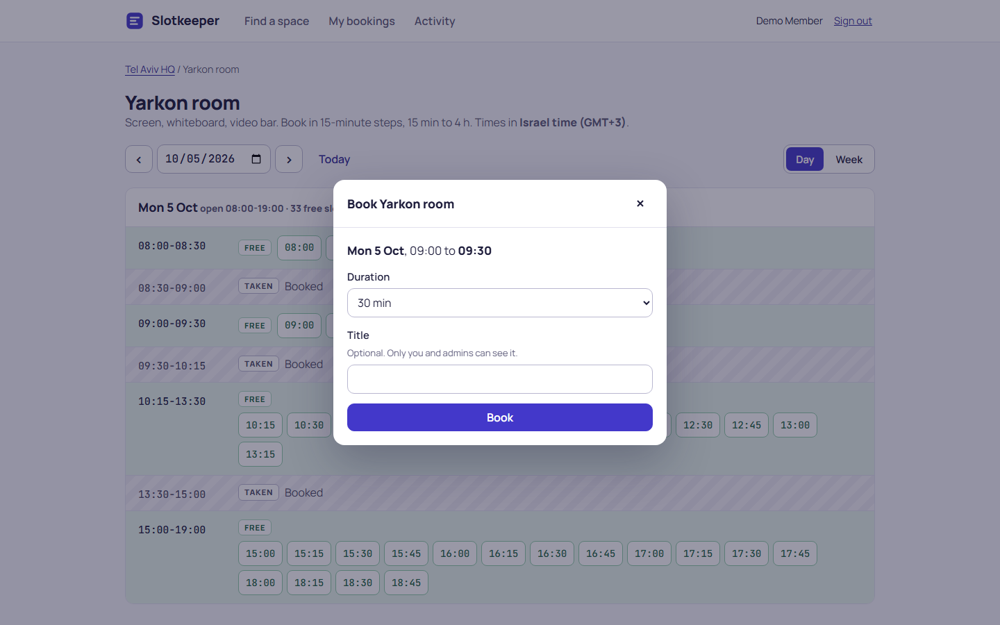
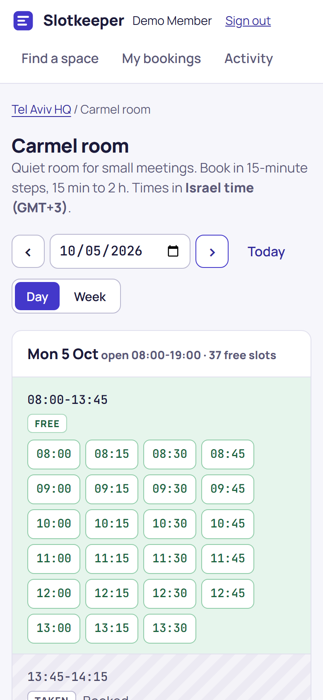

# Slotkeeper

Booking for meeting rooms, desks and equipment across offices in different time zones. Two people can never
hold the same slot: the database itself refuses overlapping reservations, and the API turns that into a clear
"pick another time" answer.



**Specialisation shown:** Backend engineering: transactions, concurrency and API design, with integration tests
that race real requests against PostgreSQL.

## Product film

[](https://github.com/gad-rapaport/slotkeeper/releases/download/v0.1.0/slotkeeper-film.mp4)

20 seconds, no sound needed: two people press Book on the same slot at the same moment, the database lets one
in, the other gets a clear 409 and a free slot, and thirty simultaneous requests still produce one booking.
[Download or play the MP4](https://github.com/gad-rapaport/slotkeeper/releases/download/v0.1.0/slotkeeper-film.mp4)
(release asset; needs access to this repository while it is private). Made from code in
[animation/](animation/): [brief](docs/ANIMATION-BRIEF.md), [storyboard](docs/ANIMATION-STORYBOARD.md),
[rendering](docs/ANIMATION-RENDERING.md).



## What it does

- Browse resources per office and type; see a day or week schedule in the office's own time zone.
- Book with taps or clicks, no dragging. Durations respect each resource's step, minimum and maximum.
- Change or cancel your bookings; admins schedule maintenance blocks and may cancel conflicting bookings in
  the same transaction.
- Opening hours, past times, booking horizon, same-day bookings and a per-user limit are enforced on the server.
- Every change is written to an activity log. Other members' booking titles stay private.

| Week view                          | Booking                                         | Phone                                     |
| ---------------------------------- | ----------------------------------------------- | ----------------------------------------- |
|  |  |  |

## How double booking is prevented

1. **Database guarantee.** `EXCLUDE USING gist (resource_id WITH =, period WITH &&) WHERE (status = 'active')`
   on one `reservations` table for bookings and maintenance. Periods are half-open `tstzrange`s, so 10:00-11:00
   and 11:00-12:00 do not conflict. [Migration](server/migrations/001_init.sql)
2. **Orderly contention.** Writers of one resource take a transaction-scoped advisory lock first. Without it,
   concurrent overlapping inserts can deadlock inside the exclusion index (this was observed in testing; see
   [docs/DECISIONS.md](docs/DECISIONS.md#isolation-and-locking)). A deadlock that still happens is retried.
3. **Idempotent creation.** `POST /api/bookings` requires an `Idempotency-Key`; a retried request returns the
   original booking instead of failing or creating a second one.
4. **Proof.** [tests/integration/concurrency.test.ts](tests/integration/concurrency.test.ts) fires 24
   simultaneous requests for one slot (exactly one 201, 23 x 409) and 16 staggered overlapping requests (no
   overlapping rows, no 5xx). `npm run simulate` does the same against the running stack.

## Stack

TypeScript on Node.js 24, Fastify 5, PostgreSQL 18 (`btree_gist`, exclusion constraint, advisory locks),
Zod, Argon2id, React 19, Vite, Manrope and JetBrains Mono served locally. Vitest, Playwright with axe-core.
Hand-written OpenAPI 3.1 contract kept honest by a test. Docker Compose, GitHub Actions.

## Quick start

```powershell
./scripts/ops.ps1 setup      # random .env, build, start, seed
npm run simulate             # 30 simultaneous requests for one slot against the running stack
```

Open **http://127.0.0.1:8103**. Sign in as `demo@slotkeeper.test` (member, no bookings yet) or
`admin@slotkeeper.test`. Passwords are generated into the local `.env` (`SEED_MEMBER_PASSWORD`,
`SEED_ADMIN_PASSWORD`). The API contract is served at `/api/openapi.yaml`.

```powershell
./scripts/ops.ps1 start | stop | status | logs app | seed | backup | test
./scripts/ops.ps1 restore backups/<file>.dump -Yes
./scripts/ops.ps1 reset-demo -Yes
```

## Tests

| Suite                                                                        | Count       | Command                    |
| ---------------------------------------------------------------------------- | ----------- | -------------------------- |
| Unit (time zones and DST, booking rules, schedule helpers)                   | 20          | `npm run test:unit`        |
| Integration (contention, idempotency, rules, privacy, maintenance, contract) | 26          | `npm run test:integration` |
| E2E (desktop and phone, axe-core)                                            | 6           | `npm run test:e2e`         |
| Contention simulation (running stack)                                        | 30 requests | `npm run simulate`         |

[docs/TESTING.md](docs/TESTING.md) has scenarios, results and gaps.

## Documentation

[Architecture](docs/ARCHITECTURE.md) · [Decisions](docs/DECISIONS.md) · [API](docs/API.md) ·
[OpenAPI](docs/openapi.yaml) · [Setup](docs/SETUP.md) · [Security](docs/SECURITY.md) ·
[Testing](docs/TESTING.md) · [Operations](docs/OPERATIONS.md) · [Deployment](docs/DEPLOYMENT.md) ·
[Design](docs/DESIGN.md) · [Demo script](docs/DEMO.md) · [Exercises](docs/EXERCISES.md) ·
[Slim profile](docs/SLIM.md) · [Storage](docs/STORAGE.md) · [Changelog](CHANGELOG.md)

## Limitations

- No recurring bookings, invitations or calendar sync.
- Per-resource serialisation means one resource accepts writes one at a time; fine for a booking system,
  not for a high-throughput ledger.
- Seeded colleagues may exceed the per-user limit (seed data bypasses the API); the demo account does not.

All people and companies are fictional; emails use the reserved `.test` domain. No licence has been chosen for
this code yet; font licences are listed in [docs/DESIGN.md](docs/DESIGN.md#assets-and-licences).
