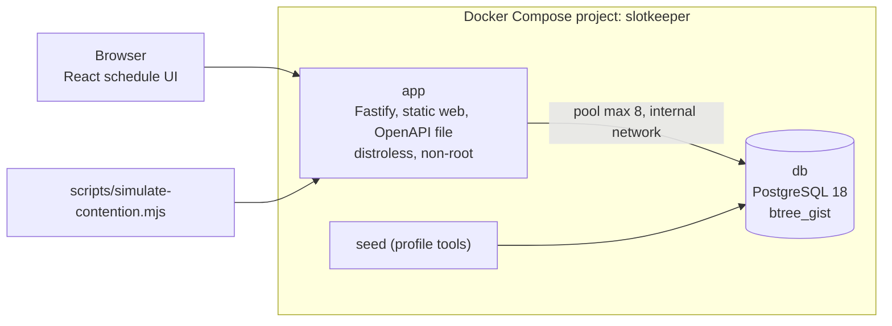
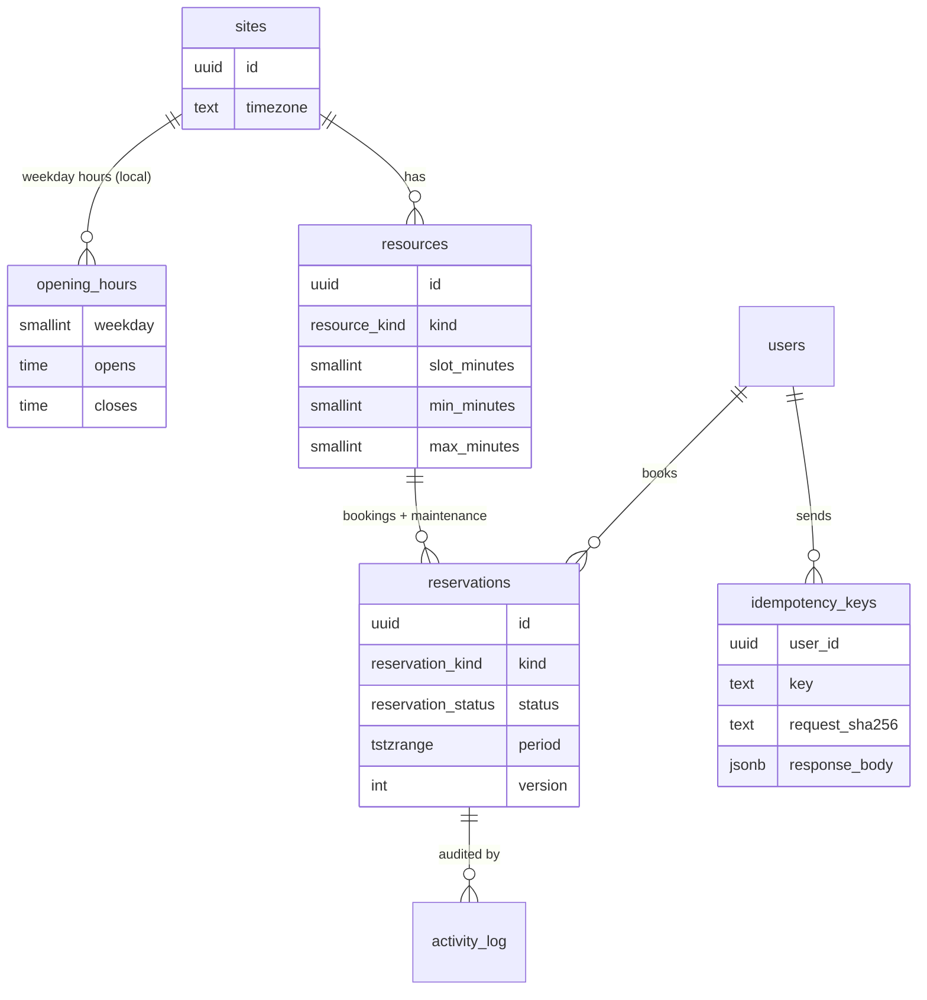

# Architecture

## Components



The structure follows Fieldline (routes, services, repositories, pure domain functions); this file focuses on
what is specific to booking.

## Data model



- **One table for bookings and maintenance** so a single exclusion constraint keeps both apart.
- **`tstzrange` `[start, end)`** stores instants; local rules are evaluated in the site zone in code.
- **Status instead of delete:** cancelled rows stay for audit and are excluded from the constraint by its
  `WHERE (status = 'active')` predicate.

## Time zones

- Each site has an IANA zone. Opening hours are local wall-clock times per ISO weekday.
- [server/src/domain/time.ts](../server/src/domain/time.ts) converts local date and time to instants with
  `Intl` only: ambiguous autumn times resolve to the earlier instant, non-existent spring times move forward.
  Local days are 23 or 25 hours on change days; availability reports `dayLengthHours`.
- The API accepts only ISO instants with an offset and returns both the instant and local strings
  (`localDate`, `localStart`, `localEnd`), so clients never need to do zone maths.

## Creating a booking

```mermaid
sequenceDiagram
  participant C as Client
  participant S as Service
  participant DB as PostgreSQL
  C->>S: POST /api/bookings + Idempotency-Key
  S->>DB: BEGIN (READ COMMITTED)
  S->>DB: SELECT users ... FOR NO KEY UPDATE (serialise this user)
  S->>DB: INSERT idempotency_keys ... ON CONFLICT DO NOTHING
  alt key exists
    S-->>C: stored response (Idempotent-Replayed: true) or 422 if body differs
  else new key
    S->>S: checkWindow (hours, steps, horizon, past)
    S->>DB: pg_advisory_xact_lock(resource)
    S->>DB: count upcoming bookings (per-user limit)
    S->>DB: INSERT reservations (exclusion constraint)
    S->>DB: INSERT activity_log; UPDATE idempotency_keys with response
    S->>DB: COMMIT
    S-->>C: 201
  end
  Note over S,DB: 23P01 exclusion violation -> 409 SLOT_TAKEN with the conflicting times;<br/>40P01 deadlock -> whole transaction retried (max 3)
```

## Lock order

Always **user row, then resource advisory lock, then reservation rows**. Reschedule reads the booking without
a lock to learn its resource, takes the resource lock, then locks the row; maintenance takes the resource lock
and then the conflicting rows. A consistent order means these paths cannot deadlock each other.

## Background work

An hourly timer in the app process deletes expired sessions and idempotency keys older than 24 hours.
